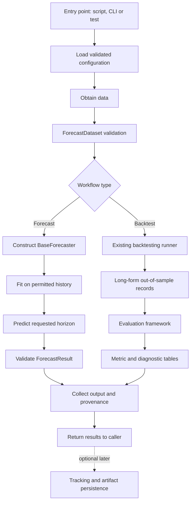

# Pipeline Architecture

# 01. Purpose

Define how the existing forecasting components are assembled into **reproducible testable workflows**. The pipeline layer coordinates configuration, validate data, model construction, fitting, forecasting, backtesting, evaluation, and outputs. It must not reimplement the algorithms, validation rules, temporal splitting, or metric formulas owned by those components.

The initial objective is a small, deterministic, **single-series, point-forecast workflow** that can be executed repeatedly and tested end-to-end. Model comparison, multi-series execution, tracking, and production deployment follow once that vertical slice is reliable. 

---

# 02. Realtionship to the Existing Architecture

| Component/ Document | Owns | Pipeline Responsibility |
|---|---|---|
| Configuration (`01`) | Loading, validation, environment settings | Load once; pass validated settings to components | 
| `ForecastDataset` (`04`) | Dataset scehma, chronological data and metadata | Obtain and validate input; do not duplicate its validator |
| `BaseForecaster`, `ForecastResult` (`03`) | Model fit/predict interface and output contract | Construct model, call `fit`/`predict`, consume results |
| Model Registry (`06`) | Model identity and cosntruction policy | Resolve models when registry is implemented; use explicit factory initially |
| Backtesting(`07`) | Folds, independent fir per fold, alignment and forecast records | Invoke runner with validated inputs and preserve its output |
| Evaluation(`08`) | Row scoring, metrics, grouping, matched comparisons | Invoke evaluator on runner output; do not calculate metrics in the pipeline | 
| Experiment tracking (`12`) | Run history, artifacts and lifecycle | Supply provenance and artifacts when tracking exists |
| Logging and monitoring (`10`) | Observability and operational signals | Emit structured lifecycle events; avoid custom monitoring subsystem |
| Deployment (`15`) | Packaging and execution infrastructure | Expose stable workflow entry points for execution environments |

**Architecture rule:** `src/ts_forecasting_lab/pipelines/` is already present. Extend it when implementing orchestration; do not create another orchestration package or rename the established modules.

---

# 03. Design Principles

1. **Composition over duplication:** call the established components and preserve their interfaces.
2. **Vertical delivery:** first deliver one complete dataset-to-evaluation run, then extend capabilities.
3. **Chronological integrity:** prohibit target, feature, transformation, and cross-series leakage.
4. **Determinism:** record configuration, model settings, data identity, and seed where applicable.
5. **Explicit Boundaries:** input validation, fit/predict, backtest, evaluation, and persistence have separate owners.
6. **Fail visibly:** no fabricated predictions, silently dropped folds, or zero-filled undefined metrics.
7. **Idempotent outputs:** repeated runs must not corrupt or ambiguously write artifacts.
8. **Architecture stability:** introduce new files only for concrete responsibilities and corresponding tests.
9. **Minimal initial dependencies:** local execution must not require a workflow scheduler, cloud service, database, or proprietary experiment platform.

---

# 04. Pipeline Types and Initial Scope 

| Workflow | Intended operation | Initial status |
|---|---|---|
| **Training and Forecasting** | Validate data → fit model  → forecast future periods | First vertical slice | 
| **Backtesting and Evaluation** | Generate historical folds → forecast → evaluate errors | First vertical slice; reuse exisiting runner |
| **Model Comparison** | Backtest multiple models → align matched observations → compare | Next increment |
| **Batch Inference** | Load approved artifact → validate inputs → forecast | Future, after persisitence contract |
| **Scheduled Retraining** | Trigger a versioned training/evaluation run | Future operational concern |
| **Production Serving** | Expose controlled inference endpoint | Defined separately in `11` and `15` |

Do not combine model selection, hyperparameter optimization, serving, and monitoring into the first pipeline implementation.  

---

# 05. End-to-end Architecture Diagram

The **piepline** controls sequencing and execution context. It does **not** own fold generation, forecast alignment, metric formulas, or model-specific algorithms. 

---

# 06. Concrete Current-status Contracts

---

# 07. Pipeline Input Contract 

---

# 08. Training and Forecasting Workflow

---

# 09. Backtesting and Evaluation Workflow

---

# 10. Example Chronological Execution

---

# 11. Model Construction and Lifecycle

---

# 12. Pipeline Output Contracts

---

# 13. Configuration and Reproducibility 

---

# 14. Data Leakage and Temporal Safety 

---

# 15. Error Handling and Execution States 

---

# 16. Logging and Observability Boundary 

---

# 17. Artifact Storage and Idempotency

---

# 18. Entry Points and Module Pleacement  

---

# 19. Testing Startegy

## 19.1 Unit Tests

## 19.2 Integration Tests

## 19.3 Golden Numerical Tests

## 19.4 Negative and Property Tests

---

# 20. Acceptance Criteria 

---

# 21. Incremental Implementation Plan 

---

# 22. Out of Scope for the First Principle 

---

# 23. Relationship to Subsequent Documents

---

# 24. Current Status and Next Action

---