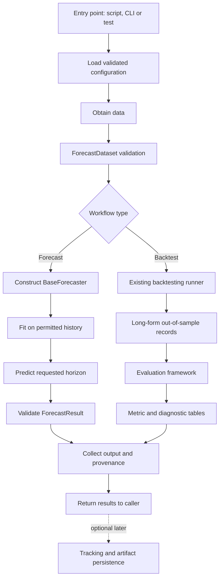
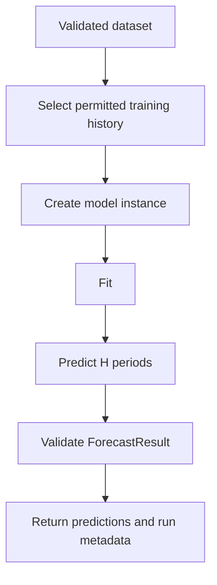
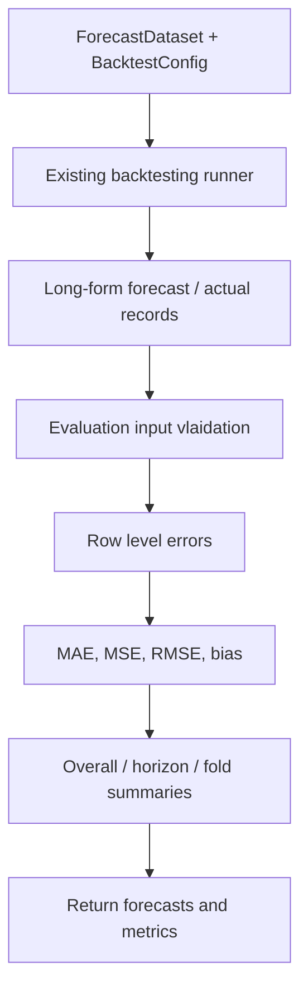

# Pipeline Architecture


# 01. Purpose

Define how the existing forecasting components are assembled into **reproducible testable workflows**. The pipeline layer coordinates configuration, validate data, model construction, fitting, forecasting, backtesting, evaluation, and outputs. It must not reimplement the algorithms, validation rules, temporal splitting, or metric formulas owned by those components.

The initial objective is a small, deterministic, **single-series, point-forecast workflow** that can be executed repeatedly and tested end-to-end. Model comparison, multi-series execution, tracking, and production deployment follow once that vertical slice is reliable. 

---

# 02. Realtionship to the Existing Architecture

| Component/ Document | Owns | Pipeline Responsibility |
|---|---|---|
| Configuration (`01`) | Loading, validation, environment settings | Load once; pass validated settings to components | 
| `ForecastDataset` (`04`) | Dataset scehma, chronological data and metadata | Obtain and validate input; do not duplicate its validator |
| `BaseForecaster`, `ForecastResult` (`03`) | Model fit/predict interface and output contract | Construct model, call `fit`/`predict`, consume results |
| Model Registry (`06`) | Model identity and cosntruction policy | Resolve models when registry is implemented; use explicit factory initially |
| Backtesting(`07`) | Folds, independent fir per fold, alignment and forecast records | Invoke runner with validated inputs and preserve its output |
| Evaluation(`08`) | Row scoring, metrics, grouping, matched comparisons | Invoke evaluator on runner output; do not calculate metrics in the pipeline | 
| Experiment tracking (`12`) | Run history, artifacts and lifecycle | Supply provenance and artifacts when tracking exists |
| Logging and monitoring (`10`) | Observability and operational signals | Emit structured lifecycle events; avoid custom monitoring subsystem |
| Deployment (`15`) | Packaging and execution infrastructure | Expose stable workflow entry points for execution environments |

**Architecture rule:** `src/ts_forecasting_lab/pipelines/` is already present. Extend it when implementing orchestration; do not create another orchestration package or rename the established modules.

---

# 03. Design Principles

1. **Composition over duplication:** call the established components and preserve their interfaces.
2. **Vertical delivery:** first deliver one complete dataset-to-evaluation run, then extend capabilities.
3. **Chronological integrity:** prohibit target, feature, transformation, and cross-series leakage.
4. **Determinism:** record configuration, model settings, data identity, and seed where applicable.
5. **Explicit Boundaries:** input validation, fit/predict, backtest, evaluation, and persistence have separate owners.
6. **Fail visibly:** no fabricated predictions, silently dropped folds, or zero-filled undefined metrics.
7. **Idempotent outputs:** repeated runs must not corrupt or ambiguously write artifacts.
8. **Architecture stability:** introduce new files only for concrete responsibilities and corresponding tests.
9. **Minimal initial dependencies:** local execution must not require a workflow scheduler, cloud service, database, or proprietary experiment platform.

---

# 04. Pipeline Types and Initial Scope 

| Workflow | Intended operation | Initial status |
|---|---|---|
| **Training and Forecasting** | Validate data → fit model  → forecast future periods | First vertical slice | 
| **Backtesting and Evaluation** | Generate historical folds → forecast → evaluate errors | First vertical slice; reuse exisiting runner |
| **Model Comparison** | Backtest multiple models → align matched observations → compare | Next increment |
| **Batch Inference** | Load approved artifact → validate inputs → forecast | Future, after persisitence contract |
| **Scheduled Retraining** | Trigger a versioned training/evaluation run | Future operational concern |
| **Production Serving** | Expose controlled inference endpoint | Defined separately in `11` and `15` |

Do not combine model selection, hyperparameter optimization, serving, and monitoring into the first pipeline implementation.  

---

# 05. End-to-end Architecture Diagram



The **pipeline** controls sequencing and execution context. It does **not** own fold generation, forecast alignment, metric formulas, or model-specific algorithms. 

---

# 06. Concrete Current-status Contracts

The initial implementation must inspect the actual repository code before committing signatures. The following contracts are already established in the project:

| Interface | Current meaning | Pipeline obligation |
|---|---|---|
| `ForecastDataset` | Validated time-series dataset | Pass the validated dataset to downstream components without mutating caller data |
| `BaseForecaster.fit(data, **kwargs)` | Fit on pandas DataFrame | Provide training-only data and preserve model-specific parameters |
| `BaseForecaster.predict(data, **kwargs)` | Return `ForecastResult` | Supply positive horizon; validate resulting predictions |
| `ForecastResult` | Contains predictions, horizon, model name, frequency, metadata | Do not invent a competing forecast schema | 
| `BacktestConfig` | Expanding/sliding, initial size, horizon, step, gap, optional window size | Use the existing validated configuration object |
| `generate_folds` | Chronological fold boundaries | Do not reproduce fold arithmetic inteh pipeline. |
| Backtesting runner | Independent model per fold, fir, predict, and align | Invoke through its implemented interface, after inspection |
| Evaluation (`08`) | Consumes long-form runner records | Integrate only once evaluator API is implemented and tested |

The runner emits long-format columns including `run_id`, `model_id`, `series_id`, `fold_id`, `forecast_origin`, `target_timestamp`, `horizon`, `y_true`, `y_pred`, `fit_status`, and `predict_status`. 

**Important:** The evaluator functions in `08_evaluation_framework.md` are conceptual until implemented. Thsi document does not claim they already exist. 

---

# 07. Pipeline Input Contract 

An initial pipeline invocation requires:

| Input | Required | Rule |
|---|---|---|
| Validated dataset | Yes | Must satisfy `ForecastDataset` contract |
| Model factory or explicit constructor | Yes | Must produce a compatible `BaseForecaster`; new instance per backtest fold |
| Model identifier | Yes | Stable and nonempty; distinct from display name |
| Workflow type | Yes | Explicit forecast or backtest/evaluate operation |
| Forecast horizon | Yes | Positive integer; interpreted in dataset periods |
| Backtest configuration | For backtest | Existing `BacktestConfig`, not a duplicate schema |
| Evaluation metric selection | For evaluation | Supported metrics; no silent fallback |
| Run identifier | Recommended | Stable identifier for correlating records and outputs |
| Optional execution context | Optional | Seed, data version, code revision, artifact destination |

For initial development, callers may construct these inputs directly in tests or a minimal script. YAML integration must use the existing configuration reader and schema; do not add an independent configuration parser.

---

# 08. Training and Forecasting Workflow



Requirements:

- The fit stage receives only observations permitted at the chosen forecast origin.
- For a future forecast, the origin is the latest observed target available to the caller. 
- Forecast horizon is validated before invoking `predict`.
- `ForecastResult.predictions` must be checked against the actual model contract; do not assume a data-indexed output if the model currently returns `step` and `yhat`. 
- The pipeline may attach contextual metadata outside the model output but must not silently change `ForecastResult` fields.
- Persistence is optional for the first version; returning a structured in-memory result is sufficient.

---

# 09. Backtesting and Evaluation Workflow



The pipeline calls the existing runner, **not** `generate_folds` plus a second homemade fold executor. The runner remains teh authority for fold isolation, `gap`, origin\target alignment, and prediction collection.

For `gap = g` and evaluated window length `H`, the runner predicts through `g + H` periods and evaluates horizons `g + 1` through `g + H`. The pipeline must preserve these horizon values; it must not relabel the first evaluated row as horizon 1 when `g > 0`.

The evaluation layer, not the pipeline, owns duplicate-key checks, undefined metric policies, pooled versus micro aggregation, and matched-cohort comparisons. 

---

# 10. Example Chronological Execution

Assume daily observations through January 13, an expanding backtest with `initial_train_size = 10`, `horizon = 3`, `step = 1`, and `gap = 0`. 

```text
Calendar day: Jan 1 ......... Jan 10 | Jan 11 Jan 12 Jan 13
Fold 1:     [training   ]| h=1 h=2 h=3
                    ^ origin Jan 10

Calendar day: Jan 1 ......... Jan 11 | Jan 12 Jan 13 Jan 14
Fold 2:     [training   ]| h=1 h=2 h=3
                    ^ origin Jan 11
```

Fold 2 is eligible only if January 14's actual is present in the backtesting dataset. Both folds may evaluate Jan 12; their records remain distinct becuase the forecast origins and horizons differ.

| fold_id | forecast_origin | target_timestamp | horizon | Meaning |
|---|---|---|---|---|
| 1 | 2026-01-10 | 2026-01-11 | 1 | One-day-ahead forecast |
| 1 | 2026-01-10 | 2026-01-12 | 2 | Two-day-ahead forecast |
| 1 | 2026-01-10 | 2026-01-13 | 3 | Three-day-ahead forecast |
| 2 | 2026-01-11 | 2026-01-12 | 1 | New origin, one-day-ahead forecast |
| 2 | 2026-01-11 | 2026-01-13 | 2 | New origin, two-day-ahead forecast |
| 2 | 2026-01-11 | 2026-01-14 | 3 | Three-day-ahead forecast| 

No pipeline code should alter this distinction when combining or summarizing outputs. 

---

# 11. Model Construction and Lifecycle

- **Initial:** pass a model factory/constructor compatible with the existing backtesting runner. Inspect its exact callable signature before integration.

- **Each backtest fold:** create a fresh model instance and fir it only for that fold's training history.

- **Single forecast:** create and fit one instance unless and explicitly supported artifact-loading path is provided. 

- **Later:** resolve model identifiers and parameters through the existing model registry design. 

- **Never:** reuse a fitted model across folds by accident, mutate shared hyperparameters, or infer model capabilities solely from filenames. 

The presence of empty `arima.py`, `xgboost.py`, `lstm.py`, or registry files does not imply that their runtime implementation exist.

---

# 12. Pipeline Output Contracts

| Output | Minimum content | Owner |
|---|---|---|
| Forecast output | Existing `Forecastresult`, plus optional external execution metadata | Forecaster + pipeline wrapper |
| Backtest observations | Existing long-format runner schema | Backtesting runner |
| Evaluation summary | Metric, value, group keys, counts, coverage | Evaluation framework |
| Run summary | Run ID, workflow model, config/data references, status | Pipeline |
| Failue report | Stage, exception class, safe message, relevant run/fold context | Pipeline + component | 
| Artifacts | Explicitly named tables, metadata, and model artifacts if enabled | Tarcking/persistence layer later | 

A **small typed result wrapper** is acceptable if it compares existing outputs without changing them. The initial implementation should  avoid a large genralized result hierarchy.

---

# 13. Configuration and Reproducibility 

The configuration system already exists. Pipleine-level configuration should be added to its established schema **only after** an executable use case proves the need. Do not add new YAML files or keys speculatively.

Capture, where available:

- Run ID and workflow type.
- Dataset identity, series selction, frequency and time range.
- Model ID, constructor parameters and relevant library versions.
- Backtest configuration, including `gap`, `step`, `horizon` and window strategy.
- Evaluation metric selection and aggregation mode.
- Random seed where the model supports deterministic execution.
- Git revision or code version, plus environment/dependendency version.
- Start/end timestamps and final execution status. 

A reproducibility claim must identify which information is actually captured versus not yet available. Do not claim byte-identical outputs or nondeterministic or hardware-sensitive model without evidence. 

---

# 14. Data Leakage and Temporal Safety 

| Leakage Type | Required Control | Owner|
|---|---|---|
| Future targets in training | Training cutoff strictly precedec evaluated targets | Dataset/backtesting |
| Feature leakage | Compute lag/rolling features using only origin/available information | Feature component |
| Transformation leakage | Fit scalers and imputers only on training portion | Feature component |
| Future covariates | require documented availability at issuance time | Model/feature component |
| Cross-fold state leakage | fresh model instance per fold | Backtesting runner |
| Hyperparameter selection leakage | Keep final holdout outside tuning loop | Experiment design |
| Cross-series leakage | Enforce compatible cutoffs across panel/global models | Future multi-series design |

The pipeline enforces ordering and refuses incompatible stages; it does not replace the lower-level leakage tests.

---

# 15. Error Handling and Execution States 

Use clear stage boundaries:

```text
CREATED->VALIDATING->RUNNING->EVALUATING->COMPLETED
                   \         \           \
                    ----------> FAILED <---
```

These are **conceptual lifecycle states**, not a requirement to add state machine library.

| Failure | Initial Behaviour |
|---|---|
| Invalid configuration | Fail before model construction |
| Invalid dataset | Fail before training or backtesting |
| Model construction or fit error | Fail with model/run context; do not fabricate outputs |
| Prediction or alignment error | Fail with fold/origin context where available |
| Invalid evaluation records | Reject and surface evaluator validation message |
| Unsupported metrics | Fail explicitly; do not substitute another metric |
| Persistence failure (when enabled) | Report partial execution separately from computation success | 

Initial prefer **fail fast**. Partial-fold continuation, retries, and resume/checkpoint policies require separate documented contracts before implementation. Never classify an incomplete run as successfully evaluated. 

---

# 16. Logging and Observability Boundary 

The pipeline should emit concise, structured lifecycle information: `run_id`, workflow, stage, model ID, fold count where relevant, start/end time, duration, status, and safe error category. Avoid per-row log spam and sensitive raw observations. 

Detailed logger configuration, metrics, alerts, retention and monitoring belong to `10_logging_and_monitoring.md`. This document establishes **what the piepeline needs to report**, not a second monitoring architecture. 

---

# 17. Artifact Storage and Idempotency


---

# 18. Entry Points and Module Pleacement  


---

# 19. Testing Startegy

## 19.1 Unit Tests


## 19.2 Integration Tests


## 19.3 Golden Numerical Tests


## 19.4 Negative and Property Tests


---

# 20. Acceptance Criteria 


---

# 21. Incremental Implementation Plan 


---

# 22. Out of Scope for the First Principle 

Distributed scheduling, DAG orchestartion platform, automatic hyperparameter tuning, parallel folds, streaming ingestion, online learning, Kubernetes, cloud-specific services, feature stores, model promotion/rollback, dashboards, probabilitic forecasting, hierarchical reconciliation, and optimization/design intelligence. These are legitimate future capabilties, not prerequisites for the initial end-to-end workflow. 

---

# 23. Relationship to Subsequent Documents

- **`10_logging_and_monitoring.md`** defines structured logs, monitoring signals and operational alerts.

- **`11_model_serving.md`** defines inference endpoints and serving semantics. 

- **`12_experiment_tacking.md`**  is the *current tracked filename* for experiment tracking (note the spelling); its design owns tracking/persistence decisions. Renaming should be a deliberate cleanup, not an implicit pipeline change.

- **`13_plugin_architecture.md`** defines optional extensions.

- **`14_testing_strategy.md`** defines repository-wide testing standards.

- **`15_deployment_architecture.md`** defines production packaging, execution, and recovery.

- **`16_future_roadmap.md`** defines long-term architectural evolution.

Do not create a separate production-architecture document; production belongs in `15_deployment_architecture.md`.

---

# 24. Current Status and Next Action

**Verified existing foundation:** configuration, dataset, `BaseForecaster`, `ForecastResult`, Seasonal Naive, fold generation, and the backtesting runner have nonempty implementations and have been exercised by tests in the user's development environment. The most recently user-reported full test checkpoint was **96 passed, 1 warning**; this is historical evidence, not a fresh test execution.

**Design completed, implementation unverified:** `08_evaluation_framework.md` defines evaluation, but its Python implementation must be checked before pipeline integration.

**Not implemented at this checkpoint:** the `pipelines/` package contains only an empty initializer, and the existing `scripts/train.py`, `scripts/forecast.py`, and `scripts/evaluate.py` are empty.

**Next action:** inspect the current `runner.py`, `base.py`, `naive.py`, `dataset.py`, and evaluation implementation (if any). Implement the smallest pipeline composition and golden integration test without modifying their established contracts.

**Maintenance rule:** update this document when an actual pipeline interface or responsibility changes. Preserve the existing architecture unless a verified technical need justifies an explicit decision.


---