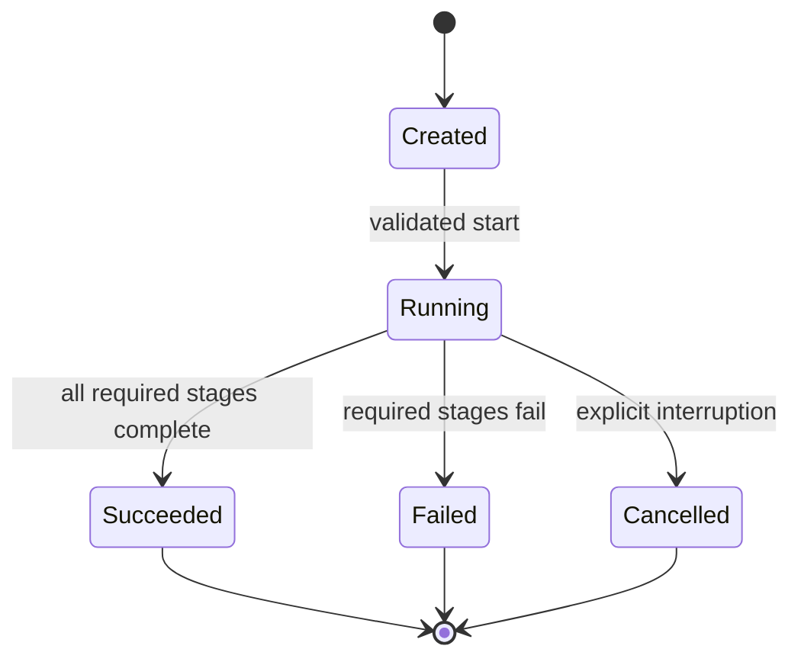

# Logging and Monitoring Architecture

# 01. Purpose

Define how thw platform records **what happened, when, where, why it failed, and whether the forecasting system remains healthy**. Logging captures individual execution events; monitoring aggregates signals and evaluates operational or statistical health over time. Both must be designed around existing pipeline contracts, rather than implemented as a parallel forecasting framework. 

The initial deliverable is a reliable, structured, privacy-conscious **local execution logging** for a single-series point-forecast workflow. Production metrics, alerting, model frift, dashboards, and serving telemetry are incremental extensions, not prerequisites for a correct first release. 

---

# 02. Relationship to Existing Architecture and Ownership

| Owner | Responsibility | Observability boundary |
|---|---|---|
| Configuration Sysytem (`01`) | Validate runtime settings | Expose logging configuration; do not create a second configuration loader |
| `ForecastDataset` (`04`) | Data and schema validation | Report validation outcome, row counts and time bounds, not raw sensitive values |
| `BaseForecaster` / `ForecastResult` (`03`) | Model fit/predict | Report duration and status of the caller boundary; avoid forcing logging into the model interface | 
| Backtesting (`07`) | Folds, fitting, predictions, alignment | Report fold lifecycle, failures, and coverage using existing identifiers |
| Evaluation (`08`) | Metrics and comparisons | Publish validated aggregate metric summaries, not independently recomputed metrics |
| Pipeline (`09`) | End-to-end orchestration | Establish run context, emit lifecycle events, aggregate outcomes | 
| Experiment tracking (`12`) | Persistent experiment history and artifacts | Store authoratative run artifacts and provenance; logs link to run IDs |
| Serving (`11`) | Inference request lifecycle | Add request latency, availability and prediction diagnostics when implemented |
| Deployment (`15`) | Infrastructure, runtime and operations | Select log collectors, metrics backends, alert routing and retention policies | 

**Do not change** the tested `ForecastDataset`, `BaseForecaster`, `ForecastResult`, `BacktestConfig`, `BacktestFold`, backtesting runner or evaluator output schemas solely to support logging. Use adapters or contextual wrappers at their existing boundaries.  

---

# 03. Design Principles

1. **Structured and contextual:** machine-readabale event fields with stable names, rather than parsing free-text messages.
2. **Separation of concerns:** Logs describe events; metrics aggregate behavior; traces connect steps; evaluation calculates forecast accuracy.
3. **Non-invasive:** Instrument the orchestration boundary before instrumenting individual models.
4. **Reproducible:** Correlate events to `run_id`, `model_id`, and `fold_id` where available. 
5. **Explicit outcomes:** Never log a failed or skipped step as successful.
6. **No hidden side effects:** Observability failure must not silently chaneg predictions or metric calculations. 
7. **Data minimization:** Do not log target arrays, feature matrices, credentials, tokens, full request pauloads or personally identifiable data by default. 
8. **Progressive sophistication:** Start with standard library `logging`; introduce OpenTelemetry or a metrics backend only when a real operational requirement arises. 
9. **Bounded cost:** Avoid per observation log storms, excessive cardinality, and unbounded artifact retention.
10. **Testability:** Validate emitted events, context, redaction and error behavior in automates tests.


---

# 04. Observability Layers

| Layer | Primary question | Examples | Initial status |
|---|---|---|---|
| Execution Logs | What happened? | `pipeline.started`, `fold.failed` | Initial design |
| Operational metrics | How often and how long? | Run success rate, stage duration, failure counts | Basic aggregation first |
| Data quality monitoring | Is input trustworthy? | Missingness, duplicates, unexpected time gaps | Report existing validator results |
| Forecast quality monitoring | Are forecasts useful? | MAE/RMSE by model/horizon, bias over time | Consume evaluation outputs |
| Model/data drift | Has the environment changed? | Feature distribution shifts, residual drift | Later, with baselines |
| Distributed traces | Where was time spent across services? | Pipeline-to-serving trace | Later, when distributed |
| Alering | Who needs to act? | Repeated failures, latency SLO breach | Production extension |

**Important distinction:** Backtest accuracy is *offline evaluation*. Production accuracy monitoring requires actual outcomes to arrive later and be joined to prior predictions without leakage or duplicate scoring.

---

# 05. High-level Observability Architecture

```mermaid
flowchartTD
A[Validated configuration]-->B[Pipeline run context]
B --> C[Dataset validation]
C --> D[Model and backtesting execution]
D --> E[Evaluation]
E --> F[Pipeline completion]
B -. structured events .-> L[Logging adapter]
C -. validation summaries .-> L
D -. stage and fold events .-> L
E -. metric summaries .-> L
F -. final status .-> L
L --> O[Console/rotating file: initial]
L -. future .-> M[Central log collection]
F -. provenance and artifacts .-> X[Experiment tracking: document 12]
E -. evaluated metrics .-> Q[Quality monitoring: future]
M -. future .-> R[dashboards and alerts]
Q -. future .-> R
```

The diagram is a **proposed design**. It does not imply that any collector, dashboard, monitoring server, or alert integration currently exists.

---

# 06. Event Contract 

A log event should be a structured record with the following recommended fields. Fields may be null or omitted where the component has no meaningful value. 

| Field | Type | Rule |
|---|---|---|
| `timestamp_utc` | ISO 8601 string | UTC, timezone-aware |
| `level` | enum | `DEBUG`, `INFO`, `WARNING`, `CRITICAL` |
| `event_name` | string | Stable dotted event identifier, e.g. `pipeline.started` |
| `message` | string | Concise human readabale description |
| `run_id` | string/null | Same identifier as pipeline/backtest records |
| `model_id` | string/null | Same identifier as forecast/evaluation records |
| `series_id` | string/null | Nullable for single-series workflows |
| `fold_id` | integer/null | Positive when tied to a backtest fold |
| `stage` | string/null | E.g. `data_validation`, `backtesting`, `evaluation` |
| `status` | enum/null | `started`, `succeeded`, `failed`, `skipped` |
| `duration_ms` | number/null | Nonnegative monotonic elapsed duration |
| `error_type` | string/null | Exception class or stable error category |
| `error_code` | string/null | Optional stable programmatic code |
| `schema_version` | string | Version of event contract, initially `1` |

**Additional optional context:** `config_fingerprint`, `dataset_fingerprint`, `forcast_origin`, `horizon`, `n_rows`, `n_folds`, `n_predictions`, `metric_name`, `metric_value`. Only include fields appropriate to the event; never attach full data frames or parameters object indiscriminately. 

**Identifiers and cardinality:** `run_id` is essential in logs but must not be used as a high-cardinality *metrics label* in systems such as Prometheus. Likewise, do not label operational metrics by raw timestamps, request IDs, or unbounded series IDs. 

## 06.1 Example JSON event (illustrative)

```json
{
  "timestamp_utc": "2026-11-07T10:00:00Z",
  "level": "INFO",
  "event_name": "backtesting.fold_completed",
  "message": "Fold completed successfully",
  "schema_version": "1",
  "run_id": "run-example-001",
  "model_id": "seasonal_naive",
  "series_id": null,
  "fold_id": 2,
  "stage": "backtesting",
  "status": "succeeded",
  "duration_ms": 42.6,
  "n_predictions": 3
}
```

The values above are **synthetic examples**, not measured platform results.

---

# 07. Event Taxonomy and Severity 

| Event | Recommended level | When emitted |
|---|---|---|
| `pipeline.started` | INFO | Run context and validated configuration established |
| `pipeline.completed` | INFO | Required stages completed and output validated |
| `pipeline.failed` | ERROR | Required stage failed; run successful |
| `stage.started` | INFO | A pipeline stage begins |
| `stage.completed` | INFO | A pipeline stage begins |
| `stage.failed` | ERROR | Stage fails, with safe exception metadata |
| `dataset.validation_failed` |ERROR | Dataset contract violated |
| `backtesting.fold_started` | DEBUG |  Fold execution begins (optional at INFO for small runs)
| `backtesting.fold_completed` | DEBUG | Fold execution succeeds | 
| `backtesting.fold_failed` | ERROR | Fit, predict or alignment fails | 
| `evaluation.completed` | INFO | Validated metrics produced | 
| `evaluation.coverage_warning` | WARNING | Missing matched observations or incomplete coverage |
| `artifact.write_failed` | ERROR | Required output could not be persisted |
| `monitoring.signal_unavailable` | WARNING |  Optional monitoring sink unavailable | 

**Severity policy:** `WARNING` means the run may remain valid but requires attention; `ERROR` means an operation failed. A warning must never be silently transformed into success signal. For high fold counts, log per-fold events at DEBUG or aggregate them to avoid excessive output. 


---

# 08. Run Lifecycle and State Transitions



A run must have exactly one terminal state (`succeeded`, `failed`, or `cancelled`) in it authoratative run summary. Duplicate event delivery can occur in external logging systems; consumers must not treat event count as a substitute for run-state truth. Stage retries, if introduced, should carry an explicit attempt number and shoudl not erase previous failures.

---

# 09. Instrumentation Boundaries and Correlation 

**Recommended initial pattern:** the pipeline creates a *run context* once, passes it to its *execution wrapper*, and uses a *logging adapter* to *attach consistent identifiers*. A context-aware logger, `LoggerAdapter`, or equivalent standard library approach is sufficient; do not mandate an additional dependency for its first implementation. 

1. Load and validate configuration via the existing configuration system.
2. Assign or accept a unique `run_id` at the orchestartion boundary.
3. Log `pipeline.started` after validation and before execution.
4. Surround each stage with a monotomic timer and emit start, success or failure.
5. For backtesting, attach the **existing** `model_id`, `fold_id` and optional `series_id`. 
6. For evaluation, log the number of scored observations and numeric summaries derived from evaluator outputs.
7. Emit exactly one authoratative terminal run summary, even when exceptions propagate.

Use `time.perf_counter()` or another monotonic clock for elapsed duration; wall-clock UTC timestamps are for event ordering and correlation, not precise duration calculations. 

---

# 10. Logging Configuration 

Configuration ahould extend the existing validated settings model **only when implementation requires it**. These are concepual keys, not a claim about current YAML or Pydantic fields. 

| Proposed settings | Default concept | Purpose |
|---|---|---|
| `logging.level` | INFO | Minimum severity |
| `logging.format` | `json` for machine ingestion; readabale text only | Log representation |
| `logging.console_enabled` | `true` | Local developer visibility | 
| `logging.file_enabled` | `false` initially | Optioanl file sink | 
| `logging.file_path` | null | Explicit path when file sink enabled | 
| `logging.redact_fields` | Known sensitive field list | Defense in depth |
| `logging.include_traceback` |  `true` for local errors, controlled in production | Debuggability | 

**Configuration rules:** Validate levels and paths, avoid writing secrets to logs, do not overwrite teh application root logger indiscriminately, and avoid duplicate handlers when initialization is called twice. Do not create a second configuration loader.

---

# 11. Operational Metrics

| Metric (cocneptual) | Type | Definition/aggregation |
|---|---|---|
| `forecast_pipeline_runs_total` | Counter | Number of runs by terminal status and pipeline type |
| `forecast_pipeline_duration_seconds` | Histogram | End-to-end run duration |
| `forecast_stage_duration_seconds` | Histogram | Duration by bounded stage name |
| `forecast_backtest_folds_total` | Counter | Completed\failed fold attempts by status |
| `forecast_predictions_total` | Counter | Valid emitted prediction records |
| `forecast_artifact_write_failures_ total` | Counter | Failed required artifacts write |
| `forecast_serving_requests_total` | Counter | Future API request counts by status |
| `forecast_serving_latency_seconds` | Histogram | Future inference request latency |

**Initial implementation:** timers and counts in run summaries or structured logs are enough. Exporters and dashbaords are deferred until deployment design identifies an actual destination. 

**Label policy:** Allow only bounded labels such as `stage`, `status`, `pipeline_type`, and a controlled `model_family`; avoid raw `run_id`, arbitrary exception text, target timestamp, and unconstrained series identifiers.  

---

# 12. Data Quality Monitoring

Data quality signals must be **derived from the dataset validation contract** and ingestion diagnostics rather than independent, inconsistent validators. 

| Signal | Example check | Action |
|---|---|---|
| Schema compliance | Required timestamp/target columns | Fail invalid input according to dataset contract |
| Missingness | Count and percentage of null targets or features | Reject or report according to agreed data policy |
| Chronology | Duplicate or unsorted timestamps | Enforce dataset rules; log summarized failure |
| Frequency integrity | Missing expected periods | Report only when frequency/calendar semantics are defined |
| Volume | Unexpectedly small/large input | Warn against a documented baseline; do not invent one |
| Freshness | Age of latest observation | Evaluate against source-specfied SLA, if defined | 
| Distribution Shift | Change in target/feature distribution | Future monitoring with reference cohort and thresholds |

A validation failure is not automatically a drift alert. Data quality, data drift, and forecast error should be represented as separate signals. 

---

# 13. Forecast Quality Monitoring

**Offline:** Consume evaluation outputs (`08_evaluation_framework.md`) with `run_id`. `model_id`, `horizon`, observation count, and cohort definitions. Track MAE, RMSE, MSE and signed bias without recomputing them inside the monitoring layer. 


**Online(future):** Store predictions with their issuance time and target timestamp. When actuals becoem available, join on stabel identity keys and calculate realized error only for matured predictions. A forecast for a target not yet observed is **pending**, not wrong or missing. 

| Signal | What it reveals | Important caveat |
|---|---|---|
| MAE by horizon | Typical absolute errors | compare on equivalent horizons/cohorts |
| RMSE by horizon | Large-error sensitivity | Same units as target |
| Signed bias |  Persistent over/underforecasting | Define sign consistent with evaluation design |
| Coverage | Fraction of eligible predictions with actuals | Distinguish pending, unavailable and invalid actuals |
| Performance vs Baseline | Model value relative to naive forecast | Match forecast origins and targets | 
| Stability over time | Changes in recent realized errors | Accounting for overlapping windows and small samples | 

**Do not** use ordinary row-wise significance tests on overlapping rolling-origin forecasts without handling dependence. Alert thresholds must be based on a justified baseline and wnough matured observations, not an arbitrary fixed percentage.

---

# 14. Drift Monitoring (Future Extension)

Distinguish three phenomena:

1. **Data drift:** Input or target distributions differ from an agreed reference period. 
2. **Concept drift"** Relationship between available predictors and target changes; may be reflected in deteriorating realized forecast accuracy.
3. **Operational drift:** Changes in runtime, latency, failure rate, or dependency behaviour. 

Possible techniques: population stability index with documented bins, KS statistics where appropriate, distribution distance, rolling residua summaries, and change-point analysis. These are **candidate methods**, not universally valid defaults. Specify the baseline, window, sample size, seasonality treatment, multiple-testing policy, and alert threshold before enabling them. 

Do not flag seasonality or legitimate level changes as drift merely because two adjacent windows differ. Do not claim concept drift based solely on a feature-distribution test.

---

# 15. Alering and Incident Response (Production Extension)

| Condition | Initial response | Owner/routing |
|---|---|---|
| Repeated pipeline failures | Inspect stage/error code and last successful run | Assigned pipeline operator |
| Missing scheduled run | Check scheduler and execution environment | Deployment operator |
| Data freshness beach | Verify upstream availability and ingestion | Data owner | 
| Serving error/latency breach | Check request failures, resource limits and model loading | Serving operator |
| Sustained forecast degradation | Review matched-cohort errors, baseline and data changes | Forecast/model owner |

Alerts must have severity, owner, runbook, threshold, evaluation window, suppression/deduplication rule, and recovery condition. No pager, email integration, or service-level objective is assumed to exist today. Define numerical SLOs with stakeholders before deployment. 

**Incident workflow:** detect → conform scope and validity → identify affected runs/models → contain or revert if necessary → restore → document root cause and corrective action. Rollback mechanics belong to `15_deployment_architecture.md`.  

---

# 16. Errors, Exceptions, and Failure Policy

- **Configuration/data contract errors:** Fail fast, record safe error category, and preserve the original exception for the caller.
- **Model fit/predict errors:** Attach run/model/fold context; follow the runner's existing fail-fast or documented fold policy.
- **Evaluation errors:** Fail the required stage; do not fabricate a metric or substitute zero. 
- **Artifact persistence failures:** Fail the run if the artifact is required for acceptance; optional outputs amy be warning under explicit policy.
- **Log sink failure:** Prefer a safe fallback (e.g., stderr) where possible. If required audit logging cannot be guaranteed, apply a separately documented strict policy. 
- **Interruption/Cancellation:** Emit a cancelled terminal state when technically possible; recognize abrupt process termination may prevent final event emission. 

Do not swallow exceptions just to log them. Use exception chaining and avoid duplicate stack traces at every layer. An error should be logged atthe responsible boundary and then propagate or handled according to the existing component contract.

---

# 17. Privace, Security, and Retention 

**Never log by default:** secrets, access tokens, passwords, raw dataset rows, complete feature matrices, full prediction arrays, , personally identifying attributes, or unrestricted user-provided strings.

**Prefer:** counts, hashes/fingerprints (only if non-sensitive and appropriately designed), time ranges, schema names, model identifiers, and summarized statistics. A dataset fingerprint is not necessarily anonymous; its use must be assessed for the data involved.

Recommended controls: least-privilege access to log stores, redaction of sensitive fields, safe exception formatting, configurable retention, log rotation for file sinks, and explicit deletion/retention policies before production. Actual retention durations and storage locations are **deployment decisions**, not invented defaults in this document.
 

---

# 18. Logging vs Experiment Tracking vs Artifacts

| Information | Primary home | Reason |
|---|---|---|
| Lifecycle events and exceptions | Logs | Time-ordered diagnostic evidence |
| Run parameters, code/data version, metric snapshots | Experiment tracking (`12`) | Reproducible experiment history |
| Forecast rows, evaluation tables, model artifacts | Defined artifact storage | Structured outputs, not log messages |
| Stage durations, success/failure rates | Operational metrics | Aggregated operational health |
| Alert status and incident ownership | Monitoring/incident system | Operational response |

The same `run_id` should link these systems when available. **A log file is not a substitute for a versioned experiment store, and experiment tracking is not a substitute for operational logs.**


---

# 19. Proposed Module Placement and Dependencies

Follow `00_repository_structure.md` and the current package layout:

- `src/ts_forecasting_lab/monitoring/` **already exists**. Use it for a small shared logging/monitoring adapter only when needed; do not introduce a second observability hierarchy. 
- `src/ts_forecasting_lab/pipeline` owns orchestration and shoudl call the adapter at stage boundaries. 
- `src/ts_forecasting_lab/config` remains the source of validated configuration.
- `tests/` should contain focus observability tests following the established test conventions; exact filenames are implementation choices.  
- `scripts/` or the existing CLI may select output format and log level when executable entry points are implemented.

**Initial dependencies:** Python standard-library `logging`, `json`, `datetime`, and `time` are sufficient. Optional future integrations include OpenTelemetry, Prometheus-compatible metrics, and a log aggregation backend, but **none is mandated** until an operational need and deployment design justify it.

---

# 20. Worked Example: Three-Fold Backtest 

**Illustrative input:** a validated daily series. `SeasonalNaiveForecaster`, expanding window backtesting, three eligible folds, forecast horizon 3, `gap=0`.

| Sequence | Event | Context/result |
|---|---|---|
| 1 | `pipeline.started` | `run_id=example-001`, `stage=pipeline` |
| 2 | `stage.completed` | `stage=data_validation`, `n_rows=30` |
| 3 | `stage.started` | `stage=backtesting` |
| 4 | `backtesting.fold_completed` | `fold_id=1`, `n_predictions=3` |
| 5 | `backtesting.fold_completed` | `fold_id=2`, `n_predictions=3` |
| 6 | `backtesting.fold_completed` | `fold_id=3`, `n_predictions=3` |
| 7 | `stage.completed` | `stage=backtesting`, `n_folds=3`, `n_predictions=9` |
| 8 | `evaluation.completed` | `n_observations=9`, metrics computed by evaluator | 
| 9 | `pipeline.completed` | Terminal status `succeeded` | 

The nine forecast records may include repeated target timestamps at different origins/horizons; logs should report counts, while the evaluation contract preserves distinct forecast keys. This example does not claim a real run was executed.

## 20.1 Failure variation 

If fold 2 raises a model fit exception under fail-fast policy, emit `backtesting.fold_failed` with `fold_id=2` and safe `error_type`; then emit `stage.failed` and `pipeline.failed`. **Do not emit** `evaluation.completed` or `pipeline.completed` for that failed run. Partial artifacts, if any, must be explicitly marked incomplete.

---

# 21. Testing Strategy 

## 21.1 Unit tests

- Correct UTC timestamp formatting, event names, severity, and schema version.
- Required run/model/fold context is attached when available.
- Durations are nonnegative and based on a monotonic clock.
- Sensitive fields are redacted or excluded.
- Invalid log levels and configuration values fail validation.
- Initializing logging twice does not duplicate handlers.
- JSON event serialization is deterministic for supported types and does not mutate inputs.

## 21.2 Integration tests

- Run the current Seasonal Naive backtesting workflow and capture emitted lifecycle events.
- Verify successful stages and terminal state agree with actual runner/evaluator outcomes.
- Trigger a deterministic model failure; confirm error context and absence of false success.
- Verify fold counts and prediction counts match runner output, including nonzero `gap`.
- Confirm existing dataset, model, backtesting and evaluation contracts remain unchanged.

## 21.3 Operational tests (when deployed)

- Collector/sink outage and fallback behavior.
- Log rotation, access control and retention enforcement.
- Bounded metrics labels and absence of high-cardinality IDs.
- Alert firing, deduplication, recovery, and runbook routing.
- Clock/timezone consistency and correlation across services.

## 21.4 Property / negative tests

- No successful terminal state after a required-stage failure.
- No raw target array or secret appears in captured logs.
- Repeated identical input does not change deterministic forecast results because of instrumentation.
- Missing optional context does not crash event serialization.
- Empty/invalid evaluation outputs never generate fabricated quality metrics.

---

# 22. Acceptance Criteria


## Initial logging milestone

- [ ] A run emits structured start and exactly one authoratative terminal summary when the process can complete normally.
- [ ] Each required pipeline stages records outcome and elapsed duration. 
- [ ] Backtesting failures can be traced to `run_id`, `model_id`, and `fold_id` where applicable. 
- [ ] Event fields and severity follow a documented, versioned contract.
- [ ] Logs exclude sensitive raw data and credentials by default.
- [ ] Observability does not cahnge model predictions, evaluation metrics, or tested public interfaces. 
- [ ] Error propagation matches the existing pipeline/backtesting policy.
- [ ] Unit, integration and regression tests pass.
- [ ] Documentation distinguishes implemented behaviour from future monitoring capabilities. 

## Production monitoring milestone (later)

- [ ] Monitoring destination, retention, access control, and ervice ownership are documented. 
- [ ] Operational metrics and dashboards have stable definitions and bounded cardinality.
- [ ] Alert thresholds, runbooks, recovery rules and escalation owners are approved.
- [ ] Forecast quality monitoring scores only predictions with matured actuals and matched keys.
- [ ] Collector failure and monitoring blind spots are tested.

---

# 23. Incremental Implementation Plan 


---

# 24. Out of Scope for the Initial Release

A centralized log cluster, distributed tracing, automated drift detectors, retraining triggers, automated model rollback, per-prediction real-time dashboards, alert paging integrations, and large-scale observability infrasctructure. These may be added when production use cases justify their cost and operational ownership. 

---

# 25. Dependencies, Current Status, and Next Action 

**Verified design context:** The platform already defines a configuration system, dataset, forecaster interface, backtesting runner, evaluation design and pipeline architecture. The repository includes `src/ts_forecasting_lab/monitoring/__init__.py`, but an empty package initializer is **not** evidence that logging or monitoring is implemented.

**Implementation prerequisite:** Inspect the current committed pipeline entry point, runner result schema, and configuration models before choosing function signatures or writing code. Do not assume the evaluation framework has been implemented merely because its architecture document exists.

**Next action:** Review this document against `09_pipeline_architecture.md`; then implement and test the smallest logging adapter when the executable pipeline is ready. The next architecture document in sequence is `11_model_serving.md`.

---

**Maintenance rule:** Update this document when actual event schemas, sinks, alert thresholds, or operational ownership change. Keep aspirational production integrations clearly marked as future work.
