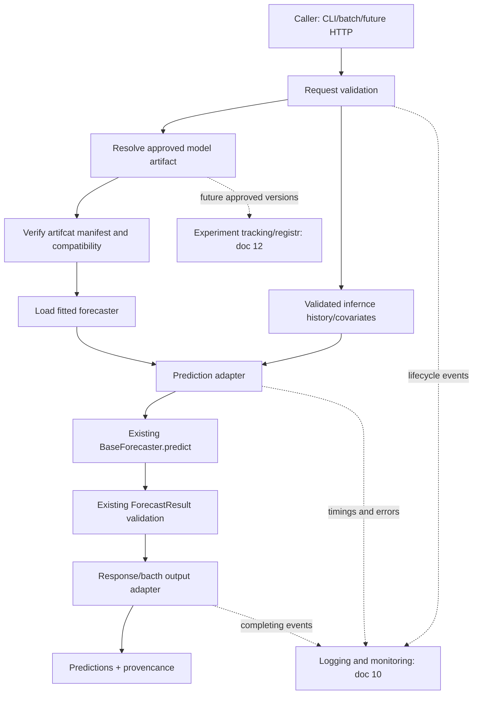
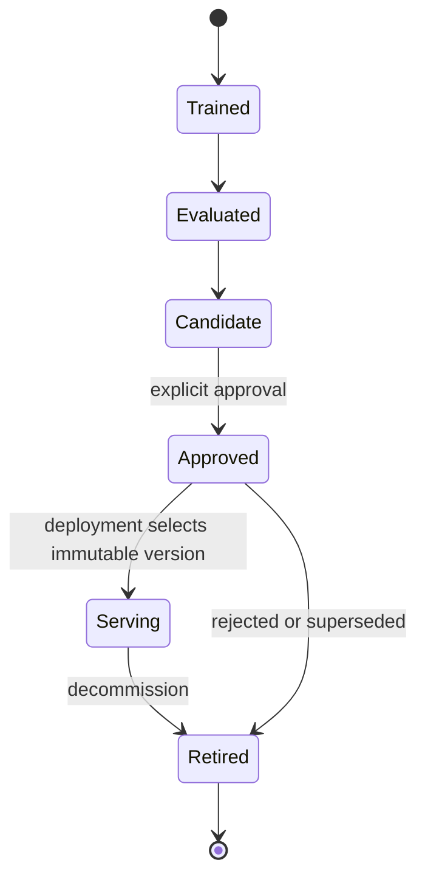

# Model Serving Architecture

# 01. Purpose

Define how a **previously trained and approved forecasting model** can produce predictions in a controlled, reproducible runtime. Servings is distinct from model development, historical backtesting, model evaluation, experiment tracking, and infrastructure development. 

The initial target is **local batch inference** for a validated, single-series, point forecast model. A synchronous HTTP API. multi-series workloads, model routing, asynchronous execution, and scalable infrastructure are alter increments. This document specifies their boundaries without asserting they already exist.

**Core rule:** A serving request must not silently fit, tune, select, or retrain a model. Training belongs to the pipeline; serving consumes a clearly identified trained artifact or explicitly documented fitted-model instance.

---

# 02. Relationship to Existing Architecture 

| Component/document | Owns | Serving responsibility |
|---|---|---|
| `03` model interface | `BaseForecaster`, `ForecastResult`, fit/predict semantics | Invoke supported prediction interface; do not replace its schema|
| `04` dataset | `ForecastDataset` and validation rules | Validate inference history through established rules |
| `06` model registry | Model identity and construction design | Resolve approved model/version once registry is implemented |
| `07` backtesting | Historical folds and out-of-sample forecasts| No backtest execution inside serving |
| `08` evaluation | Accuracy metrics and comparisons | No recomputation of evaluation metrics inside serving |
| `09` pipeline | Training, backtesting, orchestration | Supply trained artifacts and a stable handoff |
| `10` logging and monitoring | Events, telemetry, health signals | Emit serving lifecycle events and bounded metrics | 
| `12` experiment tracking | Run history, artifact provenance, lifecycle | Retrieve or reference approved artifacts when available |
| `14` testing startegy | Test levels and acceptance evidence | Implement serving-specific tests under established test structure |
| `15` deployment architecture | packaging, hosting, scaling, secrets | Choose infrastructure; serving defines runtime contract | 

**Repository rule:** Use the existing `src/ts_forecasting_lab/serving` package and `scripts/serve_api.py` placeholder when implementation is justified. Do not create a parallel serving framework or restructure the repository speculatively. 

---

# 03. Design Principles

1. **Prediction-only boundary:** no implicit fit, backtest, evaluation, or tuning.
2. **Reuse existing contracts:** `BaseForecaster`, `ForecastResult`, `ForecastDataset`, and configuration remain authoratative.
3. **Model provenance:** every result identifies the exact model artifact/version and input context. 
4. **Temporal correctness:** forecasts are anchored to a defined origin; future target observations cannot leak into inference. 
5. **Explicit capability checks:** reject unsupported frequencies, horizons, covariates, or output types. 
6. **Deterministic behavior where possible:** same approved artifact and equivalent input should yield equivalent predictions.
7. **Safe failures:** no fabricated predictions, silent model fallback, or partial success disguised as full success. 
8. **Operational simplicity:** begin with local batch execution; add a network service only when required.
9. **Security and privacy:** no arbitrary model deserialization or untrusted artifact loading. 
10. **Testable boundaries:** model loader, request validator, inference adapter, response adapter, and logging can be tested independently.

---

# 04. Serving Modes and Delivery Order

| Mode | Description | Priority |
|---|---|---|
| In-process inference | Call a known fitted forecaster through a small adapter | First development stream |
| Local batch inference | Read approved model + validated history, write predictions and manifest | **Initial deliverable** |
| CLI invocation | Exlicit inputs, artifact reference, horizon and output path | Inital or next increment |
| Synchronous REST API | Request/response inference, health checks and versioned routes | Later, when local contract is stable |
| Asynchronous batch jobs | Queue large requests and poll job status | Future
| Multi-model/multi-series routing | Select approved versions across many series | Future
| Streaming/real-time scoring | Event-driven inference with state and latency constraints | Future; not assumed necesary |

Do not treat `scripts/serve_api.py` being present as evidence of a functioning API. Inspect its contents before implementation. 

---

# 05. High-Level Serving Architecture



The diagram is a **target design**, not a claim that the loaders, API, registry, or telemetry exporters currently exist.

---

# 06. Boundary Between Training and Serving 

Training is responsible for: selecting data and features; constructing the model; fitting and tuning; evaluating on historical data; and producing an approved fitted artifact with metadata. Serving is responsible for: validating an inference request; resolving the approved artifact; prepairing permitted inference inputs; invoking prediction; validating output; and returning predictions with provenance.

**Forbidden behaviour:** `serve()` must not call `fit()` unless an explicit separate training workflow is requested. A convenience script that fits and immediately forecasts is a *training-and-forecast pipeline*, not artifact based serving. 

## 06.1 Artifact Handoff

A model is not ready for artifact-based serving until a tested save/load mechanism exists for its model family. The current base interface should **not** be expanded with mandatory `save()` and `load()` methods until conrete implementation requirements are verified. Use a family-specific serializer or a tested artifact adapter when needed. 

---

# 07. Current Model Interface Compatibility 

Established model concepts:

- `BaseForecaster.fit(data: pd.DataFrame, **kwargs)` fits a forecaster.
- `BaseForecaster.predict(horizon:int, **kwargs)` returns `ForecastResult`.
- `ForecastResult` contains `predictions` with `step` and `yhat`, plus `horizon`, `model_name`, `frequency`, and `metadata`. 

The exact signatures, constructor behavior, and serialization compatibility must be verified against repository code before implementing serving. Serving must **not** assume the model returns timestamp-indexed predictions or that every model can be reconstructed from hyperparameters alone. 

## 07.1 Fitted-model invariant 

The loader or in-process caller must establish that the forecaster is fitted. If fitted state cannot be verified, reject the request or rely on a tested model-specific contract; do not silently fit from supplied history. 

---

# 08. Conceptual Request Contract 

This is a **design-level contract**, not an implemented Pydantic schema or endpoint. 

| Field | Required? | Validation | 
|---|---|---|
| `request_id` | Recommended | Nonempty unique coorelation identifier |
| `model_id` | Yes | Stable registered or explicitly approved model identifier |
| `model_version`/`artifact_id` | Yes for artifact serving | Immutable reference; no ambiguous `latest` in reproducibility-critical runs |
| `series_id` | if multi-series | Must match artifact scope and permitted identifiers |
| `horizon` | Yes | Positive integer, supported by model and policy | 
| `forecast_horizon` | Yes or derived explicitly | Must equal last permitted observed target timestamp | 
| `frequency` | Yes or from validated data | Must match training/serving exceptions | 
| `history` or `dataset_reference` | Depends on model | Validate through existing dataset contract; do not assume all models need the same history |
| `known_future_covariates` | Only if supported | Proven available at forecast issuance time |
| `output_type` | Optional future | Point forecast initially; reject unsupported probabilistic requests |

Avoid sending full sensitive training datasets in HTTP requests. For an API, prefer controlled references or bounded inference histories as requirements evolve. 

---

# 09. Conceptual Response Contract 

Preserve the existing `ForecastResult` as the forecasting payload. A serving envelope may add operational metadata **outside** that object:

| Field | Meaning |
|---|---|
| `request_id` | Correlates response with caller and logs |
| `model_id`, `model_version` | Exact model identity |
| `artifact_digest` | Verified artifcat content hash, if available |
| `forecast_origin` | Last observed timestamp used for issuance |
| `generated_at_utc` | Response generation timestamp |
| `frequency` | Forecast calendar/frequency |
| `predictions` | Validated forecast values and, if derived, target timestamps |
| `status` | Success or explicit failure, never misleading partial success | 
| `warnings` | Nonfatal, documented limitations |

**Timestamp rule:** The model's `step` is a horizon index, not itself a timestamp. A separate adapter may derive future target timestamps only when the frequency/calendar is unambiguos. Business calendars, holidays, and irregular time axes need explicit policies; do not invent dates from row order. 

---

# 10. Worked Example: Forecast Origin and Horizon

Suppose that a validated daily series has observations through **2026-01-10** and a fitted seasonal-naive model is approved for a serving. A request for `horizon=3` measn forecast steps 1, 2, and 3 after the origin. 

| `step` | illustrative target date (daily calendar) | Meaning |
|---|---|---|
| 1 | 2026-01-11 | One period ahead |
| 2 | 2026-01-12 | Two periods ahead |
| 3 | 2026-01-13 | Three periods ahead |

These dates are valid   **only under an ordinary daily calendar**; a business-day or custom calendar produces different timestamps. The response must not contain actual future target values as input to the model. 

Backtesting's `gap` is not a serving request field by default. If a caller requests forecasts beginning several periods after the origin, define that explicitly as a future capability rather than silently relabeling horizons. 

---

# 11. Model Artifact and Manifest Design

An artifact package should have a small immutable manifest and model-specific serialized payload. 

**Illustrative manifest (not currently implemented):** 

```json
{
    "schema_version":"1",
    "model_id":"seasonal_naive",
    "artifact_format":"model-family-specific",
    "artifact_digest_sha256":"<compute digest>",
    "training_run_id":"example-run",
    "frequency":"D",
    "target_name":"y",
    "series_scope":"single-series",
    "library_version":{},
    "approved_for_serving":false
}
```

Requirements: immutable artifact identity; verified checksum; explicit serializer and library compatibility; manifest schema version; source training run when available; and approval state enforced by a trusted registry or policy. A boolean in an untrusted manifest **alone** is not authorization.

Do not deserialize untrusted `pickle`/`joblib` artifacts: these formats can execute code during loading. Use trusted, access-controlled artifacts and appropriate format-sepcific validation. Prefer safe formats when feasible.  

---

# 12. Model Lifecycle and Version Resolution



This is a conceptual lifecycle owned by tracking/registry and deployment policies. Serving checks the state but does not independently approve a model. An artifact with no verified approval must be rejected by production serving. Local development may use a clearly marked development-only override. 

Avoid mutable `latest` resolution in repeatable tests; if a human-friendly alias is offered, resolve it to an immutable version and record that version in every response. 

---

# 13. Input Data Validation and Temporal Safety

- Validate history using `ForecastDataset` or an adapter that delegates to its established checks
- Ensure the declared origin matches the actual last observed target available to the request
- Reject duplicate timestamps, invalid freqency, missing mandatory columns, and unsupported hsitory length according to teh existing dataset contract.
- Do not fit transformations on future observations.
- Distinguish observed historical covariates from genuinely known future covariates. 
- Reject a future-covariate request if teh model or data availability policy does not support it.
- Preserve timezone and calendar semantics; use CTC for operational timestamps, not as a substitute for business calendar logic.
- Never treat a missing value as zero unless that behaviour is an explicit validated domain rule.    

---

# 14. Serving Adapter and Dependency Boundaries

A minimal adapter should have four conceptual responsibilties:

1. **Resolve** the requested approved model/version.
2. **Validate** request, artifact, history, and capabilties.
3. **Predict** through the existing model interface.
4. **Present** a validated `ForecastResult` with a small provenance envelope.

Do not put model-specific feature engineering, training or metric formulas inside the serving adapter. If models need different inference preprocessing, then, package and version that preprocessing alongside the trained model, with a verified fit/transform boundary.

**Possible implementation seam:** `src/ts_forecasting_lab/serving/` may contain an adapter once a concrete interface is approved. Exact module filenames and signatures are intentionally deferred until existing source inspection and first vertical-slice tests.

---

# 15. Batch Inference Workflow

```mermaid
flowchartTD
A[Explicit batch request + model artifact ID] --> B[Validaet config and inputs]
B --> C[Verify approved artifact and load]
C --> D[Rn prediction]
D --> E[Validate ForecastResult]
E --> F[Write outputs atomically]
F --> G[Write manifest/provenance]
G --> H[Report terminal run status]
```

Initial output can be a CSV or Parquet prediction table plu a small JSON manifest. Choose the format based on existing project conventions rather than mandating both. Use temporary writes followed by atomic replacement where supported. A failed run must not leave a misleading success manifest.

For repeated requests, defien an explicit output collission policy: fail if path exists, or overwrite only with an explicit option. A determinsitic request key may aid deduplication but should not substitute for model/version identity. 

---

# 16. Future HTTP API Design

A REST service is an **optional adapter** around the same inference core; it must not implement a separate forecasting engine. 

| Illustrative endpoint | Intent | Initial status |
|---|---|---|
| `GET /health/live` | Process liveness; no heavy model execution | Future |
| `GET /health/ready` | Readiness: required model/artifact available | Future |
| `POST /v1/forecasts` | Validate request and return forecast | Future |
| `GET /v1/models/{model_id}/versions` | Approved version discovery, if authorized | Future |

These routes are **proposed**, not existing endpoints. FastAPI is a reasonable future choice because it supports typed validation and OpenAPI documentation, but it should not be added until there is a demonstrated API requirement.

## 16.1 HTTP Status Principles

- `400` or `422`: malformed/invalid request, according to selected API validation conventions.
- `401` / `403`: authentication/authorization failure.
- `404`: unknown model or artifact identifier when disclosure is permitted.
- `409`: version/state conflict, where appropriate.
- `503`: temporarily unavailable required serving dependency.
- `500`: unexpected internal failure, with safe response details.

Do not expose Python stack traces, secrets, local filesystem paths, or raw data in client-facing errors.  

---

# 17. Runtime Model Loading, Caching and Concurrency

Intial local mode may load one artifact per invocation. For future long-running services:

- Cache by **immutable model version**, not by a mutable alias.
- Bound cache size and memory; use explicit eviction and startup policies. 
- Verify thread/process safety for each model family; do not assume fitted Python estimators are safe for concurrent calls. 
- Avoid sharing mutable preprocessing state across requests.
- Establish load-on-startup versus lazy-load behaviour from latency and memory requirements.
- Treat artifact loading failures as readiness failures when the model is mandatory. 
- Record model load time separately from prediction time. 

Parallel serving and GPU allocation are deployment-specific and should not be benchmarked rather than assumed.  

---

# 18. Errors, Retries and Idempotency

| Failure Class | Required Behavior | 
|---|---|
| Invaild request or incompatible horizon | Reject; do not retry unchanged input |
| Invalid request or incomplete horizon | Reject; do not retry unchanged input |
| Missing/unapproved artifact | Reject or mark service unavailable; never select an unapproved fallback silently |
| Curropt or incompatible artifact | Fail safely; log safe error category |
| Insufficient history | Reject with actionable validation reason |
| Model prediction exception | Return failure; preserve request correlation |
| Output write failure | Mark batch run failed; avoid partial-success manifest |
| Transient infrastructure outage | Retry only when operation is safe and unbounded |

Retries must not turn one logical request into multiple inconsistent published outputs. Define request IDs and atomic output behavior before introducing automated retries.

---

# 19. Logging, Monitoring and Observability Integration 

Follow `10_logging_and_monitoring.md`. Serving should emit contextual events, not build its own competing logging system.

| Event | Meaning | Typical severity |
|---|---|---|
| `serving.request_received` | Accepted into validation boundary | INFO/DEBUG |
| `serving.request_rejected` | Validation or policy rejection | WARNING |
| `serving.model_laoded` | Verified artifact loaded | INFO |
| `serving.prediction_completed` | Validated response produced | INFO |
| `serving.prediction_failed` | Prediction failed | ERROR |
| `serving.artifact_incompatible` | Version/format mismatch | ERROR |

Measure request counts, prediction latency, load latency, validation failure rate, and availability. Use bounded metric labels (`model_family`, `status`, `route`) rather than unbounded `request_id`, arbitrary `series_id`, or raw exception messages. Log IDs for correlation, but never log entire target arrays, secrets, or unrestricted request payloads. 

**Forecast accuracy monitoring is delayed:** it requires observed outcome to arrive later and to be joined to stored forecasts by origin, target timestamp, horizon, model version, and series. Serving itself does not know future truth.

---

# 20. Security, Governance and Data Policy

- Authenticate and authorize future network callers; restrict which models and series they may access.
- Restrict artifact storage to trusted writers; verify checksums and supported formats.
- Protect against arbitrary file paths, path traversal, oversized payloads, and unbounded horizons.
- Limit request sizes and execution time; apply quotas/rate limits where needed.
- Keep credentials in deployment secret management, not in YAML committed to Git.
- Avoid sensitive target values and features in logs by default.
- Track version provenance and approval actions separately from transient request logs.
- Define retention for predictions, request metadata, and artifacts before production use.


---

# 21. Performance, Capacity and SLOs

Do not invent production performance guarantees before measurement. Define an initial benchmark matrix using representative model families, history length, horizons, and concurrent requests.

| Dimension | Benchmark question |
|---|---|
| Cold start | How long to load and validate an artifact? |
| Warm latency | How long does `predict()` take without load overhead? |
| End-to-end latency | What is the full request duration including validation and serialization? |
| Memory | Peak memory per loaded model and concurrent worker |
| Throughput | Valid forecasts per second or per batch |
| Error rate | Rejected, failed, timed-out requests by cause | 
| Recovery | How quickly can the last approved version be restored? |

Set SLOs only after collecting baseline data and agreeing on business requirements. Batch completion-time targets and online p95 latency targets are different concerns. 

---

# 22. Deployment Boundary and Infrastructure Readiness

Serving architecture defines **what** must run; `15_deployment_architecture.md` defines **where and how** it runs. Infrastructure work may proceed in parallel, but it should not force premature application dependencies. 

## 22.1 Minimal environment-neutral requirements

- Reproducible Python environment and pinned dependencies.
- Read access to trusted model artifacts and approved manifests.
- Explicit input and output locations for batch execution.
- Environment-specific configuration via existing settings conventions.
- Safe logging destination and error reporting.
- Version identification for code, data, model, and serializer.
- Health/readiness contract if an API is introduced.

## 22.2 Infrastructure decisions to defer

Cloud provider, Kubernetes, container orchestration, model registry vendor, API gateway, metrics backend, GPU provisioning, and autoscaling policy should follow measures workload needs and deployment requirements. They are not prerequisites for a correct local serving contract.

---

# 23. Testing Startegy and Acceptance Evidence


---

# 24. Incremental Implementation Plan


---

# 25. Definition of Done: Initial Serving Architecture


---

# 26. Open Design Decisions

| Decision | Recommendation | When to finalize |
|---|---|---|
| Artifact Serialization | Model-family-specific, trusted, versioned | Before persisted-model serving | 
| Artifact Approval | Explicit regsitry or controlled manifest policy | Before production |
| Forecast Timestamps | Separate calendar-aware adapter | Before exposing timestamps to callers |
| Future Covariates | Explicit availability contract per model | When exogenous models arrive | 
| API Framework | Consider FastAPI; do not require now | When network serving is requested |
| Cache/Concurrency | Benchmark by model family | Before multi-request deployment |
| Model Aliases | Resolve to immutable versions in outputs | With registry implementation |
| Probabilistic Output | Extend through a documented capability contract | When probabilitic models are implemented | 
| Online Accuracy Monitoring | Join predictions to later actuals | With production feedback pipeline | 


---

# 27. Relationship to the Next Documents

- **`12_experiment_tracking.md`:** authoritative experiment history, model artifacts, version identity and approval metadata. Serving references those artifacts but does not implement tracking.
- **`13_plugin_architecture.md`:** optional model or serializer plugins must honor the existing model interface and explicit capability checks.
- **`14_testing_strategy.md`:** formalize cross-layer test ownership, fixtures, regression gates and acceptance evidence.
- **`15_deployment_architecture.md`:** choose packaging, hosting, service operations and infrastructure from validated serving requirements.
- **`16_future_roadmap.md`:** phase advanced serving modes, multi-series and probabilistic interfaces only after the initial vertical slice is stable.

**Final architectural principle:** *A serving layer should be a thin, reliable and auditable boundary around an approved forecasting capability—not another place where forecasting, training, or evaluation logic is reimplemented.*

--- 