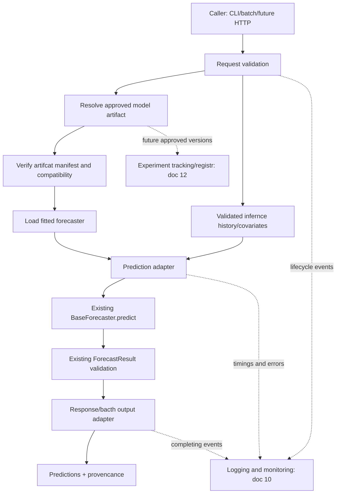

# Model Serving Architecture

# 01. Purpose

Define how a **previously trained and approved forecasting model** can produce predictions in a controlled, reproducible runtime. Servings is distinct from model development, historical backtesting, model evaluation, experiment tracking, and infrastructure development. 

The initial target is **local batch inference** for a validated, single-series, point forecast model. A synchronous HTTP API. multi-series workloads, model routing, asynchronous execution, and scalable infrastructure are alter increments. This document specifies their boundaries without asserting they already exist.

**Core rule:** A serving request must not silently fit, tune, select, or retrain a model. Training belongs to the pipeline; serving consumes a clearly identified trained artifact or explicitly documented fitted-model instance.

---

# 02. Relationship to Existing Architecture 

| Component/document | Owns | Serving responsibility |
|---|---|---|
| `03` model interface | `BaseForecaster`, `ForecastResult`, fit/predict semantics | Invoke supported prediction interface; do not replace its schema|
| `04` dataset | `ForecastDataset` and validation rules | Validate inference history through established rules |
| `06` model registry | Model identity and construction design | Resolve approved model/version once registry is implemented |
| `07` backtesting | Historical folds and out-of-sample forecasts| No backtest execution inside serving |
| `08` evaluation | Accuracy metrics and comparisons | No recomputation of evaluation metrics inside serving |
| `09` pipeline | Training, backtesting, orchestration | Supply trained artifacts and a stable handoff |
| `10` logging and monitoring | Events, telemetry, health signals | Emit serving lifecycle events and bounded metrics | 
| `12` experiment tracking | Run history, artifact provenance, lifecycle | Retrieve or reference approved artifacts when available |
| `14` testing startegy | Test levels and acceptance evidence | Implement serving-specific tests under established test structure |
| `15` deployment architecture | packaging, hosting, scaling, secrets | Choose infrastructure; serving defines runtime contract | 

**Repository rule:** Use the existing `src/ts_forecasting_lab/serving` package and `scripts/serve_api.py` placeholder when implementation is justified. Do not create a parallel serving framework or restructure the repository speculatively. 

---

# 03. Design Principles

1. **Prediction-only boundary:** no implicit fit, backtest, evaluation, or tuning.
2. **Reuse existing contracts:** `BaseForecaster`, `ForecastResult`, `ForecastDataset`, and configuration remain authoratative.
3. **Model provenance:** every result identifies the exact model artifact/version and input context. 
4. **Temporal correctness:** forecasts are anchored to a defined origin; future target observations cannot leak into inference. 
5. **Explicit capability checks:** reject unsupported frequencies, horizons, covariates, or output types. 
6. **Deterministic behavior where possible:** same approved artifact and equivalent input should yield equivalent predictions.
7. **Safe failures:** no fabricated predictions, silent model fallback, or partial success disguised as full success. 
8. **Operational simplicity:** begin with local batch execution; add a network service only when required.
9. **Security and privacy:** no arbitrary model deserialization or untrusted artifact loading. 
10. **Testable boundaries:** model loader, request validator, inference adapter, response adapter, and logging can be tested independently.

---

# 04. Serving Modes and Delivery Order

| Mode | Description | Priority |
|---|---|---|
| In-process inference | Call a known fitted forecaster through a small adapter | First development stream |
| Local batch inference | Read approved model + validated history, write predictions and manifest | **Initial deliverable** |
| CLI invocation | Exlicit inputs, artifact reference, horizon and output path | Inital or next increment |
| Synchronous REST API | Request/response inference, health checks and versioned routes | Later, when local contract is stable |
| Asynchronous batch jobs | Queue large requests and poll job status | Future
| Multi-model/multi-series routing | Select approved versions across many series | Future
| Streaming/real-time scoring | Event-driven inference with state and latency constraints | Future; not assumed necesary |

Do not treat `scripts/serve_api.py` being present as evidence of a functioning API. Inspect its contents before implementation. 

---

# 05. High-Level Serving Architecture

The diagram is a **target design**, not a claim that the loaders, API, registry, or telemetry exporters currently exist.

---

# 06. Boundary Between Training and Serving 

Training is responsible for: selecting data and features; constructing the model; fitting and tuning; evaluating on historical data; and producing an approved fitted artifact with metadata. Serving is responsible for: validating an inference request; resolving the approved artifact; prepairing permitted inference inputs; invoking prediction; validating output; and returning predictions with provenance.

**Forbidden behaviour:** `serve()` must not call `fit()` unless an explicit separate training workflow is requested. A convenience script that fits and immediately forecasts is a *training-and-forecast pipeline*, not artifact based serving. 

## 06.1 Artifact Handoff

A model is not ready for artifact-based serving until a tested save/load mechanism exists for its model family. The current base interface should **not** be expanded with mandatory `save()` and `load()` methods until conrete implementation requirements are verified. Use a family-specific serializer or a tested artifact adapter when needed. 

---

# 07. Current Model Interface Compatibility 

Established model concepts:

- `BaseForecaster.fit(data: pd.DataFrame, **kwargs)` fits a forecaster.
- `BaseForecaster.predict(horizon:int, **kwargs)` returns `ForecastResult`.
- `ForecastResult` contains `predictions` with `step` and `yhat`, plus `horizon`, `model_name`, `frequency`, and `metadata`. 

The exact signatures, constructor behavior, and serialization compatibility must be verified against repository code before implementing serving. Serving must **not** assume the model returns timestamp-indexed predictions or that every model can be reconstructed from hyperparameters alone. 

## 07.1 Fitted-model invariant 

The loader or in-process caller must establish that the forecaster is fitted. If fitted state cannot be verified, reject the request or rely on a tested model-specific contract; do not silently fit from supplied history. 

---

# 08. Conceptual request Contract 

---

# 09. Conceptual Response Contract 

---

# 10. Worked Example: Forecast Origin and Horizon

---

# 11. Model Artifact and Manifest Design

---

# 12. Model Lifecycle and Version Resolution

---

# 13. Input Data Validation and Temporal Safety

---

# 14. Serving Adapter and Dependency Boundaries

---

# 15. Batch Inference Workflow

---

# 16. Future HTTP API Design

## 16.1 HTTP Status Principles

---

# 17. Runtime Model Loading, Caching and Concurrency

---

# 18. Errors, Retries and Idempotency

---

# 19. Logging, Monitoring and Observability Integration 

---

# 20. Security, Governance and Data Policy

---

# 21. Performance, Capacity and SLOs

---

# 22. Deployment Boundary and Infrastructure Readiness

---

# 23. Testing Startegy and Acceptance Evidence

---

# 24. Incremental Implementation Plan

---

# 25. Definition of Done: Initial Serving Architecture

---

# 26. Open Design Decisions

---

# 27. Relationship to the Next Documents
