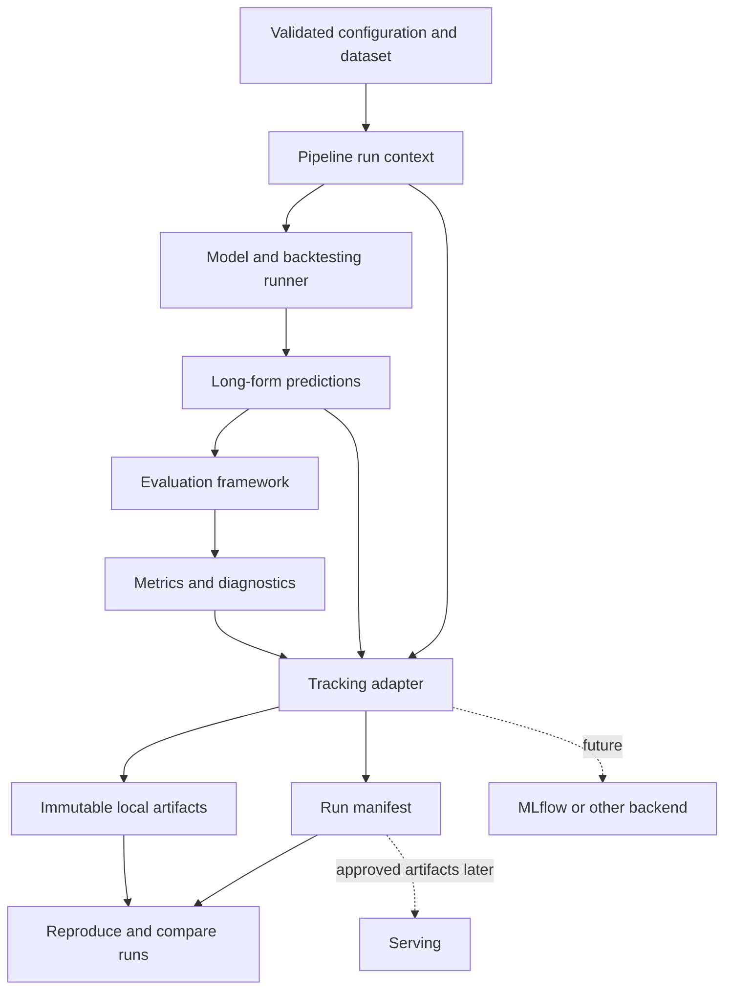
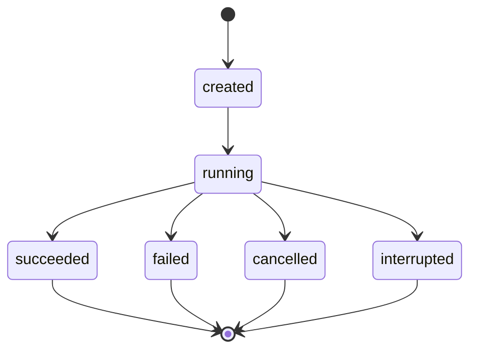

# 01. Purpose

Define reproducible identification, recording, persistence, comparison and audit of forecasting experiments. Tracking stores evidence; it does **not** fit models. generate backtesting folds, calculate evaluation metrics and serve predictions.

**Initial deliverable:** local, filesystem-backed experiment manifests and artifacts for single-series point forecasts. Do not require MLflow, databases, cloud services or model serialization in teh first implementation. 

---

# 02. Relationship to Existing Architecture

| Document/component | Owns | Tracking responsibility |
|---|---|---|
| 01 Configuration | Validated settings | Persist sanitized resolved configuration |
| 03 Model Interfaces | `BaseForecaster`, `ForecastResult` | Record model ID, parameters and version |
| 04 Dataset | `ForecastDataset` validation | Record source, identity, frequency and checksum | 
| 06 Model registry | Model discovery | Reference model identity; avoid duplicate registry |
| 07 Backtesting | Splits, fitting and long-form predictions | Persist protocol and original records |
| 08 Evaluation | Metrics, aggregation, comparison | Persist computed outputs; never recompute |
| 09 Pipeline | Workflow orchestration | Establish run context and invoke tracker |
| 10 Logging | Operational events | Correlate logs with `run_id` | 
| 11 Serving | Approved artifact inference | Provide traceable approved model references | 
| 13 Plugins | Extensibility | Optional tracking backend later |
| 14 Testing | Test strategy | Verify tracking integrity and recovery |
| 15 Deployment | Infrastructure | Configure storage, access and retention | 

Reuse existing repository paths and placeholders after inspecting the actual code. 

---

# 03. Principles

1. **Evidence over leaderboard:** store predictions, coverage and protocol, not only summary scores.
2. **Immutability:** finalized runs are read-only; corrections require new versions or runs. 
3. **Reproducibility:** capture data, code, environment, configuration, model, and temporal protocol. 
4. **Explicit failures:** failed and interrupted runs remain inspectable. 
5. **Separation:** backtesting and evaluation remain authoritative.
6. **Privacy:** do not store secrets or proprietary raw data by default.
7. **Local-first:** simple portable files before shared tracking services.
8. **Incremental:** avoid premature dependencies and schema proliferation.

---

# 04. Vocabulary and Hierarchy 

- **Study:** collections of related experiments answering one question.
- **Specification:** fixed dataset, model, parameters, evaluation protocol and environment.
- **Run:** one execution attempt with a unique `run_id`. 
- **Trial:** candidate hyperparameters or random seed, linked to a study.
- **Fold:** backtesting origin; owned by the existing runner. 
- **Evaluation:** metrics calculated from out-of-sample predictions
- **Model artifact:** fitted serialized model, only where safe save/load is implemented.
- **Approved model:** separately governed decision; not automatically the top-scoring run. 

Identical specifications can have multiple runs. Never overwrite one because its parameter match another. 

---

# 05. Architecture




---

# 06. Run Lifecycle



Each attempt has a unique ID and one authoratative termina state. Stale `running` records should be marked interrupted only after verifying the process is no longer active. Use UTC timestamps for chronology and monotonic clock for elapsed durations. 

---

# 07. Manifest Contract 

Illustrative JSON; field names must be reconciled with actual repository contracts. 

```json
{
    "schema_version":"1.0",
    "run_id":"example_run_id",
    "study_id":"seasonal-baselines",
    "status":"succeeded",
    "workflow_type":"backtest_evaluate",
    "code":{"git_commit":"example-sha","dirty_worktree":false},
    "data":{"dataset_id":"example", "sha256":"example-checksum","frequency":"D"},
    "model":{"model_id":"seasonal_naive", "parameters":{"season_length":7}},
    "backtest":{"strategy":"expanding","initial_train_size":90, "horozon":7, "step":7, "gap":0},
    "evaluation":{"metrics":["MAE","RMSE"], "aggregation":"pooled", "policy_version": "1"},
    "artifacts":[{"path":"predictions.csv", "sha256": "example-checksum"}]
}
```

Example checksums are placeholders, not valid digests. Validate actual digests and schema before finalizing. Store resolved, **sanitized** settings, not only a mutable config file path. 

---

# 08. Required Provenance

| Category | Required or recommended evidence |
|---|---|
| Code | Git commit, dirty state, package version |
| Environment | Python and dependencies; hardware when relevant |
| Data | Source, license, version, checksum, selected series, time range |
| Model | Stable ID, parameters, seed, model/library version |
| Backtest | Complete `BacktestConfig`, origins, horizon, gap, step |
| Evaluation | Metric names, aggregation, undefined-value policy, evaluator version |
| Outputs | Predictions, metrics, diagnostics, failure summary |
| Resources | Duration and measured computer/memory if available |

A seed alone does not guarantee deterministic results. Record known mondeterminism.  

---

# 09. Prediction and Evaluation Artifacts

Preserve the runner's existing long-form fields:

`run_id, model_id, series_id, fold_id, forecast_origin, target_timestamp, horizon, y_true, y_pred, fit_status, predict_status`

Do not relabel horizons when `gap > 0`; horizons remain relative to the forecast origin. Preserve timestamps, nulls and numeric precision. CSV is acceptable initially; Parquet may be added with explicit schema/version control. 

Persist evaluator-produced metrics, including grouping keys, sample counts, coverage and aggregation semantics. Tracking must not implement a second MAE/RMSE/MASE calculator. MASE requires training-derived denominations and their provenance. 

---

# 10. Local Artifact Layout 

```text
artifacts/
    experiments/
        <study_id>/
            <run_id>/
            manifest.json
            resolved_config.json
            predictions.csv
            metrics.csv
            diagnostics.json
            environment.json
            logs.jsonl
            model/      # only after tested serialization exists
```

This is a **proposed** layout, not an assertion about current folders. Confirm existing conventions first. Write into a temporary directory, verify required artifacts and hashes, then finalize atomically where supported. Completed run directories must not be mutated.

---

# 11. Comparison and Scientific Validity 

Comparisons must verify:
- Same dataset version and eligible evaluation population, or report differences explicitly.
- Matched forecast keys: series, origin, target timestamp, horizon and fold.
- Same metric definition, aggregation policy, and treatment of missing predictions.
- Comparable tuning budgets and training-history constraints.
- Clear distinction between per-observation, per-fold, per-series and per-dataset units.

Overlapping forecast errors are statistically dependent. Do not treat thousands of prediction rows as thousands of independent replications. Statistical inference belongs to the evluataion/research layer; tracking stores paired losses and analysis outputs.

---

# 12. Model Artifact Lineage and Approval

A successful run is **not** automatically approved for serving. When fitted model persistence exists, record serializer, model version, training cutoff, library versions, artifact checksum, validation evidence, and approval decision. 

Possible later governance status: `candidate → validated → approved → retired`. Never rely solely on a mutable `latest` alias. Do not load untrusted pickle/joblib artifacts; follow document 11's artifact security policy.

---

# 13. Storage Backend Choices

| Backend | Appropriate stage | Trade-off |
|---|---|---|
| JSON manifests + local files | Initial | Portable, minimal dependencies; slower search |
| SQLite metadata index | Later | Better filtering; migration and concurrency |
| MLflow | Later if needed | UI and sahred tracking; added service/dependency |
| Remote artifact storage | Team/production | Access control, retention and operations |

Begin with local manifests and simple read/list/compare utility. An index can be rebuilt from authoritative manifests. Adopt MLflow only after documenting a concrete shared tracking requirement. 

---

# 14. Logging and Monitoring Boundary 

Logging records *lifecycle events* and *operational telemetry*; experiment tracking records authoratative run metadata and artifacts. Correlate by `run_id`, but do not treat event counts as run truth.

If required artifact persistence fails, do not claim the run is reproducibly successful. Optional backend outages should be reported without silently modifying forecast values. 

---

# 15. Security, Retention and Reliability

- Redact credentials, tokens, connection strings and private payloads.
- Respect dataset redistribution licenses. 
- Validate artifact paths against traversal and unintended overwrite.
- Use unique run directories and atomic manifest writes.
- Detect missing files, corrupt manifests and checksum mismatches.
- Define retention separately for metadata, predictions and model binaries.
- Preserve inspectable failure records on disk-pull, permission and interruption errors.
- Do not publish proprietary client artifacts in a public repository.   

---

# 16. Testing Matrix


---

# 17. First-Release Acceptance Criteria


--- 

# 18. Incremental Delivery Plan


---

# 19. Open Decisions


--- 

# 20. Suggested Copilot Prompt 


---
